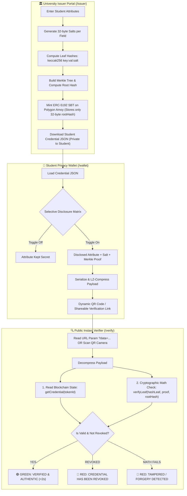

# 🛡️ VeriVault

> **Decentralized Academic Credentialing with ERC-5192 Soulbound Tokens & Zero-Knowledge Selective Disclosure on Polygon Amoy**

[-8A2BE2?logo=polygon)](https://amoy.polygonscan.com/address/0x1Ba155930d87C46B53849e3E3Cfa7C3052EC7D9c)
[](https://eips.ethereum.org/EIPS/eip-5192)
[-black?logo=next.js)](https://nextjs.org/)
[](https://github.com)
[](https://opensource.org/licenses/MIT)

---

## 📌 Live Deployment Details

- **Smart Contract**: `VeriVaultCredentials.sol` (ERC-5192 Minimal Soulbound Token)
- **Deployed Address**: [`0x1Ba155930d87C46B53849e3E3Cfa7C3052EC7D9c`](https://amoy.polygonscan.com/address/0x1Ba155930d87C46B53849e3E3Cfa7C3052EC7D9c)
- **Deployment Transaction**: [`0xbc09a571b509eeddb2f3070f1033e017920059ac660ec93d424dc23b51a19f26`](https://amoy.polygonscan.com/tx/0xbc09a571b509eeddb2f3070f1033e017920059ac660ec93d424dc23b51a19f26)
- **Chain**: Polygon Amoy Testnet (Chain ID: `80002`)
- **Default Admin & Issuer**: `0x95c9F3704D9851087C120B2f2de8369C9Bf66cb2`

---

## 💡 The Problem & The Solution

| The Traditional Problem | The VeriVault Solution |
| :--- | :--- |
| **Document Forgery**: Paper certificates & PDFs are easily manipulated with image editors. | **ERC-5192 Soulbound Tokens**: Cryptographically non-transferable, bound forever to the student's Ethereum address. |
| **Privacy Leakage**: Presenting a degree reveals full name, roll number, grades, and birthdate even when only proof of graduation is required. | **Zero-Knowledge Selective Disclosure**: Merkle tree proofs allow students to disclose *only* requested attributes (e.g., `Degree: B.Tech CSE`) while keeping all other fields mathematically sealed. |
| **Slow Verification**: Background checks take weeks and manual university contact. | **Sub-2-Second Verification**: In-browser cryptographic math check + on-chain state inspection via Viem without requiring any wallet connection from the verifier. |
| **Revocation Invalidation**: Forged credentials cannot be easily flagged when degrees are rescinded. | **On-Chain Revocation Registry**: Issuers can instantly revoke credentials with a transparent timestamp and immutable reason. |

---

## 🏗️ System Architecture



---

## 🔐 Cryptographic Specification

### 1. Salted Leaf Construction
To eliminate rainbow table attacks on low-entropy fields (such as CGPA ranges or graduation years), every attribute is combined with a 256-bit cryptographically secure pseudorandom salt:

$$\text{Leaf} = \text{keccak256}(\text{key} \parallel \text{value} \parallel \text{salt})$$

### 2. Merkle Tree
The leaves are sorted lexicographically before tree construction:

$$\text{Root} = \text{MerkleTree}(\text{Leaves})$$

Only the resulting 32-byte `rootHash` is committed to the blockchain. No personal identifiable information (PII) ever touches the public ledger.

### 3. Selective Disclosure Proof
When a student chooses to disclose attribute $i$:
1. The student provides $\{\text{key}_i, \text{value}_i, \text{salt}_i\}$.
2. The student provides the sibling hashes along the Merkle branch $\text{Proof}_i$.
3. The verifier recomputes $\text{Leaf}_i = \text{keccak256}(\text{key}_i \parallel \text{value}_i \parallel \text{salt}_i)$ and verifies that folding $\text{Leaf}_i$ with $\text{Proof}_i$ produces the exact `rootHash` stored on Polygon Amoy.

---

## ⚡ Quickstart & Setup

### Prerequisites
- Node.js `v18+` or `v20+`
- MetaMask or any Web3 wallet with Polygon Amoy testnet POL

### Installation
```bash
# Clone the repository
git clone https://github.com/your-username/veri.git
cd veri

# Install dependencies
npm install
```

### Environment Configuration
Copy `.env.example` to `.env` (already pre-configured for Polygon Amoy):
```ini
PRIVATE_KEY="<your_deployer_private_key>"
POLYGON_AMOY_RPC_URL="https://polygon-amoy-bor-rpc.publicnode.com"
NEXT_PUBLIC_CONTRACT_ADDRESS="0x1Ba155930d87C46B53849e3E3Cfa7C3052EC7D9c"
NEXT_PUBLIC_POLYGON_AMOY_RPC_URL="https://polygon-amoy-bor-rpc.publicnode.com"
NEXT_PUBLIC_WALLETCONNECT_PROJECT_ID="3a8170812b534d0ff9d794f19a901d64"
```

### Running Tests
Run the 26 automated unit tests covering both the cryptographic engine and smart contracts:
```bash
npm run contracts:test
```

### Running Locally
```bash
npm run dev
```
Open **[http://localhost:3000](http://localhost:3000)** in your browser.

---

## 🧪 Interactive Presentation & Demo Guide

### Flow 1: 1-Click Credential Issuance
1. Open **`/issuer`** and connect your MetaMask wallet.
2. Click **"Fill Demo Data (Jadavpur University)"** to autofill the form.
3. Click **"Issue Credential (Soulbound Token)"**.
4. Confirm in MetaMask. The Soulbound Token is minted on Polygon Amoy, and `VeriVault-Credential-${tokenId}.json` is downloaded immediately.

### Flow 2: Zero-Knowledge Selective Disclosure
1. Open **`/wallet`**.
2. Drop in the `.json` credential file (or click **"Load Demo Credential"**).
3. Under the **Selective Disclosure Matrix**, toggle fields:
   - Check `Degree` (`B.Tech CSE`) and `CGPA` (`CGPA >= 8.0`).
   - Uncheck `Full Name` and `Roll Number`.
4. Click **"Copy Link"** or display the generated QR code.

### Flow 3: Instant Public Verification
1. Open the copied link or visit **`/verify`**.
2. Verification takes less than 2 seconds without requiring any Web3 wallet:
   - ✅ **Green Badge**: "VERIFIED & AUTHENTIC"
   - Shows disclosed verified fields.
   - States: *"All undisclosed fields remain mathematically sealed and cryptographically unexposed."*

### Flow 4: Revocation Showcase
1. Return to **`/issuer`** and scroll to **Revocation Management**.
2. Input the `Token ID` and reason (e.g. *"Academic Integrity Violation"*).
3. Confirm revocation on-chain.
4. Refresh **`/verify`** — it immediately flashes **RED (REVOKED BY ISSUER)** with the exact on-chain reason and timestamp.

---

## 🧰 Tech Stack

- **Smart Contracts**: Solidity `0.8.24` (Cancun EVM), OpenZeppelin v5, ERC-5192, Hardhat
- **Blockchain**: Polygon Amoy Testnet (Chain ID `80002`)
- **Frontend Framework**: Next.js 14 App Router, TypeScript, Tailwind CSS
- **Web3 Client**: Viem v2, Wagmi v2, RainbowKit v2
- **Cryptographic Engine**: `merkletreejs`, `keccak256`, `lz-string`
- **Scanning**: `html5-qrcode`, `qrcode.react`
- **Component Primitives**: Radix UI, Lucide Icons, Sonner Notifications

---

## 📄 License
MIT © VeriVault Contributors
# VeriVault

