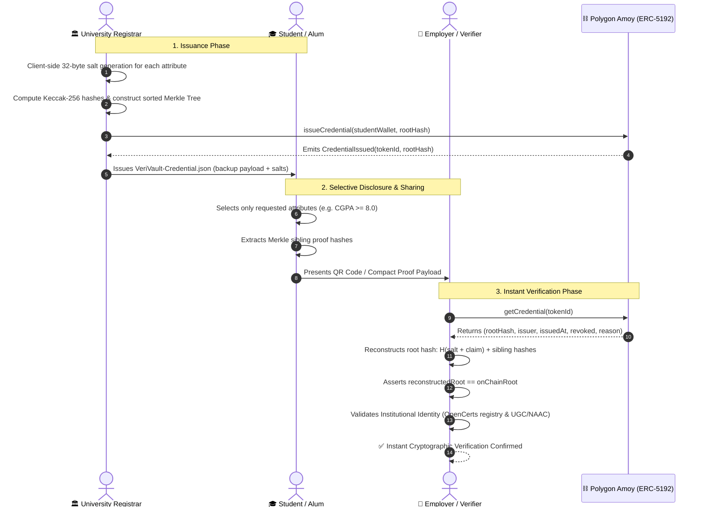

# 🛡️ VeriVault

> **Decentralized Academic Credentialing with ERC-5192 Soulbound Tokens & Zero-Knowledge Selective Disclosure on Polygon Amoy**

[-8A2BE2?logo=polygon&logoColor=white)](https://amoy.polygonscan.com/address/0x1Ba155930d87C46B53849e3E3Cfa7C3052EC7D9c)
[](https://eips.ethereum.org/EIPS/eip-5192)
[-black?logo=next.js)](https://nextjs.org/)
[](https://github.com/amit-dev01/VeriVault)
[](https://opencerts.io)
[](https://opensource.org/licenses/MIT)

---

## 📌 Live On-Chain Deployment (Polygon Amoy Testnet)

| Parameter | Value |
| :--- | :--- |
| **Smart Contract** | `VeriVaultCredentials.sol` (ERC-721 + ERC-5192 Minimal Soulbound Token + AccessControl) |
| **Contract Address** | [`0x1Ba155930d87C46B53849e3E3Cfa7C3052EC7D9c`](https://amoy.polygonscan.com/address/0x1Ba155930d87C46B53849e3E3Cfa7C3052EC7D9c) |
| **Deployment Tx** | [`0xbc09a571b509eeddb2f3070f1033e017920059ac660ec93d424dc23b51a19f26`](https://amoy.polygonscan.com/tx/0xbc09a571b509eeddb2f3070f1033e017920059ac660ec93d424dc23b51a19f26) |
| **Network & Chain ID** | Polygon Amoy Testnet (`80002`) |
| **Default Admin / Issuer** | `0x95c9F3704D9851087C120B2f2de8369C9Bf66cb2` |
| **Live Sample Token (#1)** | [Tx 0x6bb2f8beb...](https://amoy.polygonscan.com/tx/0x6bb2f8beb29d931f4679f9d35e422f0f49d4ca8d70fec0be190ddfa73026c1f4) (Committed Merkle Root: `0x72a956625402f4270fa0e93b01cace5de4b6a9dd20f684ede3bf05bd7c0fb07d`) |

---

## 🎯 Problem Statement & Background

> **Hack-N-Pitch E-Summit '26 (Web3 Track: Tamper-Proof Academic Credentials)**

* **The Problem:** Fake degrees and fabricated academic transcripts remain a multi-billion dollar crisis in global hiring and higher education admissions. Current verification workflows still rely on slow, manual phone calls, physical notarizations, and email threads that take weeks to complete and remain vulnerable to forgery.
* **The Oversharing Dilemma:** In traditional hiring, when an applicant must prove a single qualification (e.g. *"Graduated in 2028"* or *"CGPA $\ge$ 8.0"*), they are forced to submit an entire transcript, exposing sensitive personal data such as full course grades, date of birth, home address, and student IDs.
* **The Solution — VeriVault:**
  1. **Non-Transferable Soulbound Tokens (ERC-5192):** Degrees are minted directly to the recipient's decentralized wallet and cryptographically locked (`locked(tokenId) == true`). Transfers, sales, and secondary trades are rejected on-chain at the EVM bytecode level.
  2. **Zero Plaintext On-Chain (Strict Privacy):** No student names, grades, or personal identifying information are stored on the public blockchain. Every attribute is salted client-side, hashed with Keccak-256, and formed into a sorted Merkle tree. Only the 32-byte Merkle root is committed to Polygon Amoy.
  3. **Zero-Knowledge Selective Disclosure:** Students can choose to reveal only requested claims (e.g., "CGPA $\ge$ 8.0") alongside mathematical sibling hashes. Verifiers validate the claim against the on-chain Merkle root without learning any hidden attributes.
  4. **Institutional Accreditation Check (GovTech Singapore OpenCerts Standard):** Verifiers are protected against rogue smart contracts through a verified registry verifying university domains (`jadavpuruniversity.in`), official signing keys, and accreditation status (UGC & NAAC Grade A+).
  5. **Instant On-Chain Revocation:** Accredited universities maintain real-time revocation authority. Degrees revoked for misconduct are flagged permanently on-chain with an immutable reason audit trail.

---

## ⚡ How VeriVault Differs from Generic Data Vaults

| Feature | Generic Data Vaults (Web3 Tutorials) | 🛡️ VeriVault (Enterprise Academic System) |
| :--- | :--- | :--- |
| **Authority & Issuance** | Self-issued by arbitrary users (any user uploads any file). | **Accredited Institutional Issuance** restricted via `ISSUER_ROLE` smart contracts. |
| **Token Transferability** | Standard transferable ERC-721/1155 (tokens can be sold/moved). | **ERC-5192 Soulbound Tokens (SBT)** permanently locked to student's identity wallet. |
| **Privacy & Disclosure** | All-or-nothing file decryption (AES key reveals entire document). | **Zero-Knowledge Selective Disclosure** via Keccak-256 Merkle proofs. |
| **On-Chain Footprint** | Plaintext IPFS CID / raw data pointers. | **Zero Plaintext**. Only 32-byte cryptographic Merkle root committed to Polygon Amoy. |
| **Revocation Lifecycle** | None (immutable files cannot be revoked once uploaded). | **On-Chain Revocation Registry** with immutable public reasoning. |
| **Accreditation Trust** | Anonymous wallet addresses without real-world identity. | **GovTech OpenCerts Standard** with institutional domain validation & UGC/NAAC verification. |

---

## 🏗️ Architecture & Cryptographic Flow



---

## 💻 Tech Stack

- **Smart Contracts:** Solidity `^0.8.24`, OpenZeppelin Contracts v5 (`ERC721`, `AccessControl`), EIP-5192 (`IERC5192 Minimal Soulbound Tokens`).
- **Development & Testing:** Hardhat, TypeScript, Chai/Ethers.js (26 comprehensive automated tests).
- **Blockchain Network:** Polygon Amoy Testnet (Chain ID `80002`).
- **Frontend Framework:** Next.js 14 (App Router), React 18, Tailwind CSS, Lucide React, Radix UI.
- **Web3 Integration:** Wagmi v2, Viem, RainbowKit v2, TanStack Query.
- **Cryptography & Proofs:** `merkletreejs`, `keccak256`, `viem/crypto`, client-side CSPRNG salts.
- **Scanning & Compression:** `html5-qrcode`, `qrcode.react`, `lz-string`.

---

## 📁 Project Structure

```text
veri/
├── contracts/                        # Smart Contracts & Tests
│   ├── VeriVaultCredentials.sol       # ERC-5192 Soulbound Token Contract
│   ├── interfaces/
│   │   └── IERC5192.sol              # EIP-5192 Soulbound Token Interface
│   └── scripts/
│       └── deploy.ts                 # Hardhat deployment script for Polygon Amoy
├── test/
│   └── VeriVaultCredentials.test.ts   # 26 automated unit & security tests
├── src/
│   ├── app/
│   │   ├── api/
│   │   │   └── issuer/
│   │   │       ├── authorize/route.ts # 1-Click testnet registrar self-authorization
│   │   │       └── mint-relayer/route.ts # Institutional Gasless Relayer API
│   │   ├── issuer/page.tsx           # University Registrar Portal (Mint & Revoke)
│   │   ├── wallet/page.tsx           # Student Vault (SBTs & Selective Disclosure)
│   │   ├── verify/page.tsx           # Instant Verifier Portal (QR & File Upload)
│   │   ├── layout.tsx                # Root layout & Web3 provider wrapper
│   │   └── page.tsx                  # Interactive Landing Page & Explainer
│   ├── components/
│   │   ├── Navbar.tsx                # Floating navigation with wallet status
│   │   ├── Footer.tsx                # Institutional footer
│   │   └── ui/                       # Radix UI primitives
│   ├── config/
│   │   ├── contract.ts               # Deployed address & TypeScript ABI
│   │   └── institutions.ts          # GovTech OpenCerts registry (Domains, NAAC/UGC)
│   ├── lib/
│   │   └── crypto.ts                 # Merkle tree building, proofs & salt generation
│   └── providers/
│       └── Web3Provider.tsx          # RainbowKit + Wagmi Polygon Amoy configuration
├── hardhat.config.ts                 # Hardhat Amoy network configuration
├── package.json                      # Dependencies & scripts
└── README.md                         # Project documentation
```

---

## 🚀 Quickstart Guide

### 1. Prerequisites
- **Node.js:** v18.17 or higher
- **Package Manager:** `npm` or `yarn`
- **Web3 Wallet:** MetaMask, Rabby, or Coinbase Wallet with Polygon Amoy Testnet added.

### 2. Installation
```bash
# Clone the repository
git clone https://github.com/amit-dev01/VeriVault.git
cd VeriVault

# Install dependencies
npm install
```

### 3. Environment Configuration
Create a `.env` file in the root directory:
```env
# Deployer / Admin Private Key (for deployment & relayer routes)
PRIVATE_KEY="your_private_key_here"

# Polygon Amoy RPC URL
POLYGON_AMOY_RPC_URL="https://polygon-amoy-bor-rpc.publicnode.com"
NEXT_PUBLIC_POLYGON_AMOY_RPC_URL="https://polygon-amoy-bor-rpc.publicnode.com"

# Deployed Contract Address on Polygon Amoy
NEXT_PUBLIC_CONTRACT_ADDRESS="0x1Ba155930d87C46B53849e3E3Cfa7C3052EC7D9c"

# Optional: Reown / WalletConnect Project ID (free at https://cloud.reown.com)
NEXT_PUBLIC_WALLETCONNECT_PROJECT_ID="3a8170812b534d0ff9d794f19a901d64"
```

### 4. Run Smart Contract Tests
Run all 26 automated unit tests validating soulbound token immutability, role authorization, and revocation events:
```bash
npm run contracts:test
```

### 5. Launch the Local Development Server
```bash
npm run dev
```
Open [http://localhost:3000](http://localhost:3000) in your browser.

---

## 🧪 Step-by-Step Demonstration Walkthrough

### Step 1: Issuing a Degree (`/issuer`)
1. Navigate to [http://localhost:3000/issuer](http://localhost:3000/issuer).
2. Click **"Fill Demo Data"** to auto-fill sample credentials for Jadavpur University.
3. Select **"University Relayer (Gasless)"** (default) or **"Personal MetaMask"**.
4. Click **"Generate & Mint Credential"**:
   - Computes the Keccak-256 Merkle root.
   - Mints the ERC-5192 Soulbound Token on Polygon Amoy.
   - Automatically downloads the `VeriVault-Credential-#.json` backup file.

### Step 2: Student Vault & Selective Disclosure (`/wallet`)
1. Navigate to [http://localhost:3000/wallet](http://localhost:3000/wallet).
2. Upload the `VeriVault-Credential-#.json` file received from the university.
3. Select which attributes you want to disclose (e.g. check only `CGPA >= 8.0` and hide `NAME`, `ROLL_NO`, etc.).
4. Click **"Generate Selective Disclosure Proof"**:
   - Generates an instant scannable QR Code and copyable cryptographic proof payload containing only the disclosed claim and required Merkle sibling proof hashes.

### Step 3: Instant Employer Verification (`/verify`)
1. Navigate to [http://localhost:3000/verify](http://localhost:3000/verify).
2. Scan the student's QR code via webcam or upload the selective disclosure JSON proof.
3. In under 1 second, VeriVault:
   - Queries `0x1Ba155930d87C46B53849e3E3Cfa7C3052EC7D9c` on Polygon Amoy.
   - Reconstructs the Merkle root and confirms mathematical validity.
   - Verifies the issuer against the OpenCerts Institutional Registry, displaying the **Institutional Identity Card** with official university domain (`jadavpuruniversity.in`), green lock, and UGC / NAAC Grade A+ accreditation badge.

### Step 4: Revocation Audit (`/issuer` -> Revocation Tab)
1. In `/issuer`, switch to the **"Revocation Registry"** tab.
2. Enter the Token ID (e.g. `1`) and provide an official reason (e.g. *"Degree cancelled due to academic misconduct"*).
3. Confirm the on-chain revocation transaction.
4. Return to `/verify`: The credential will immediately be flagged as **Revoked & Invalidated**, showing the permanent on-chain audit reason and blocking verification.

---

## 🔒 Security & Privacy Guarantees

* **Zero Plaintext Storage:** Student personal details, grades, and identifiers never touch blockchain state or IPFS.
* **Pre-image & Dictionary Resistance:** Every attribute leaf is salted with 256 bits of cryptographically secure randomness (`Keccak256(key + ":" + value + ":" + salt)`), making brute-force dictionary attacks impossible.
* **Non-Transferable (SBT):** Overrides `transferFrom`, `safeTransferFrom`, and `approve` in `VeriVaultCredentials.sol` to revert with `ErrSoulboundToken()`, preventing academic credentials from being transferred or traded.
* **Strict Role-Based Access Control:** Only wallets holding `ISSUER_ROLE` granted by the university contract administrator can mint or revoke credentials.

---

## 📜 License

This project is licensed under the MIT License — see the [LICENSE](LICENSE) file for details.
